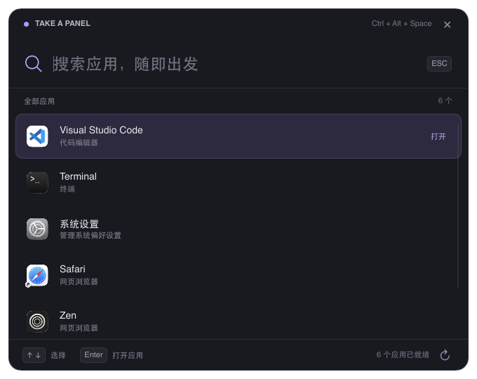

# Take a Panel

一个使用 **Rust + Slint** 编写的跨平台应用启动器。默认暗色、扁平化、圆角无边框界面，按全局快捷键唤出，搜索并启动系统中的应用。



## 运行

安装 Rust 1.92 或更新版本后，在项目目录执行：

```sh
cargo run --release
```

默认优先使用 FemtoVG / OpenGL 硬件渲染，同时编入软件渲染后端。图形初始化失败时会使用软件渲染重试一次。应用列表按可见区域创建行，大量应用不会一次生成全部界面元素；背景图片在后台按显示尺寸处理并缓存。

背景使用快速高斯近似模糊，调整不透明度会复用已解码和模糊的图片。处理后的背景保存在设置目录的 `background.rgb`，下次启动直接读取；原图、显示尺寸或外观参数变化时自动更新，缓存损坏时自动重新处理。只保留一张背景缓存。

需要强制使用软件渲染时，先退出已有 server，再设置 `SLINT_BACKEND=winit-software` 启动；`SLINT_BACKEND=winit-femtovg` 可指定 OpenGL。可运行 `cargo run --example render_check` 短暂打开测试窗口，检查实际渲染路径和截图是否正常。

默认运行会自动启动后台 server 并显示面板；已有 server 时直接调用它，客户端随即退出。之后使用 **Ctrl + Alt + Space** 显示 / 隐藏。macOS 上 Alt 对应 Option，Ctrl 对应 Control。成功启动应用或点击窗口外会隐藏面板，server 继续运行。

server 在状态栏显示 **P** 图标，菜单提供“显示面板”“刷新应用列表”“设置 → 快捷键设置”“退出 Take a Panel”。面板右上角的齿轮图标也可以打开设置，左侧提供“快捷键设置”一栏。macOS 点击图标展开菜单，Windows / Linux 可点击图标显示面板、右键打开菜单。macOS server 使用 Accessory 模式，不占用 Dock。

在设置左侧或 **P 菜单 → 设置 → 开机自启** 中，点击“请求开机自启”可向系统添加当前用户的登录启动项。启用后，登录系统时只启动后台 server，不弹出面板；点击“关闭开机自启”可以取消。页面从系统读取状态，打开页面或重新获得焦点时刷新，也可以手动刷新；不会在每次运行时自动注册或覆盖系统中的禁用决定。

- **macOS 13+**：使用系统原生 [SMAppService](https://developer.apple.com/documentation/servicemanagement/smappservice) 注册应用包内的 LaunchAgent。需要先通过 `./scripts/package-macos.sh` 打包并从签名的 `.app` 运行（建议放在“应用程序”目录）；`cargo run` / 裸二进制会显示打包提示。系统要求批准或已撤销许可时，页面显示“等待在系统设置中批准”，点击“打开系统启动项设置”后允许 Take a Panel 在后台运行。macOS 11/12 可继续使用应用，内置自启管理需要 macOS 13+。
- **Windows**：使用当前用户的 `HKCU\Software\Microsoft\Windows\CurrentVersion\Run` 启动项，无需管理员权限；如果在系统设置中禁用了该项，需在“启动应用”中重新允许。
- **Linux**：使用 [XDG Autostart](https://specifications.freedesktop.org/autostart-spec/latest/) 的 `$XDG_CONFIG_HOME/autostart/com.takeapanel.launcher.desktop`（默认 `~/.config/autostart/`），需桌面环境支持该规范。关闭时写入 `Hidden=true`，也可通过桌面的启动应用设置禁用。

Windows / Linux 启动项记录当前可执行文件的路径，移动程序后请重新关闭并启用。自启使用正常的配置目录和已保存的快捷键；本次运行的临时命令行参数、环境变量不会保存到系统启动项。

在快捷键设置中点击录入区域，直接按下实际的组合键，例如按住 Ctrl 和 Alt 后按空格，便会显示 `Ctrl+Alt+Space`，无需输入组合键名称。支持字母、数字、空格、方向键、功能键等，按键按物理位置识别，macOS Option 产生的特殊字符不会影响录入。仅按修饰键不会覆盖组合键；录入当前已启用的快捷键不会隐藏面板。点击“保存快捷键”或按 Enter 即可立即生效，并在下次启动时继续使用。“恢复默认”会填入 `Ctrl+Alt+Space`，点击保存后生效；按 Esc 或“返回面板”放弃未保存的修改。与面板内操作冲突、被其他程序占用或保存失败时显示错误，并保留原快捷键。页面同时列出面板内的固定快捷键供查阅。

```sh
# 自定义全局快捷键
cargo run --release -- --hotkey "Alt+Space"

# 只启动或复用后台 server，不显示面板；命令会立即返回
cargo run --release -- --hidden

# 在当前进程运行 server，便于服务管理器或终端直接管理
cargo run --release -- --server

# 控制已有 server
cargo run --release -- --show
cargo run --release -- --hide
cargo run --release -- --toggle
cargo run --release -- --refresh
cargo run --release -- --status
cargo run --release -- --quit

# 仅扫描、列出应用，可用于排查应用发现问题
cargo run --release -- --list

# 不注册全局快捷键
cargo run --release -- --no-hotkey
```

也可以设置环境变量 `TAKE_A_PANEL_HOTKEY`。启动时优先级为：命令行 `--hotkey` > `TAKE_A_PANEL_HOTKEY` > 设置页保存的快捷键 > 默认值。命令行和环境变量只在创建 server 时生效，已有 server 时复用原配置；设置页可以直接修改运行中的快捷键，无需重启。`--no-hotkey` 只禁用本次启动的快捷键，之后也可以在设置页保存组合键来启用。快捷键已占用时仍可从 P 菜单或命令行显示面板。

快捷键设置保存在 macOS 的 `~/Library/Application Support/TakeAPanel/hotkey`、Windows 的 `%APPDATA%/TakeAPanel/hotkey`、Linux 的 `$XDG_CONFIG_HOME/take-a-panel/hotkey`（默认 `~/.config/take-a-panel/hotkey`）。可通过 `TAKE_A_PANEL_CONFIG_DIR` 指定独立设置目录。

`--server` 在已有 server 时直接返回，不会创建第二个 server。`--show`、`--toggle` 和 `--hidden` 可以自动启动 server；`--hide`、`--refresh`、`--status` 和 `--quit` 不会自动启动 server。关闭终端不会停止自动启动的后台进程，退出请使用 P 菜单、`Ctrl + Q` 或 `--quit`。

| 操作 | 功能 |
| --- | --- |
| 输入应用名 / 关键词 | 即时搜索，支持中文、忽略大小写、多词匹配 |
| ↑ / ↓ | 选择应用，列表自动滚动 |
| Enter / 单击应用 | 启动应用 |
| Shift + Enter | 尝试新开应用实例 |
| Esc | 隐藏面板 |
| 右上角 × | 隐藏面板，保留后台 server |
| Ctrl + R / 右下角刷新 | 重新扫描应用 |
| Ctrl + Q / P 菜单退出 | 退出 server、释放快捷键 |
| 拖动顶部标题区域 | 移动窗口 |

搜索按照名称完全匹配、前缀匹配、包含匹配、关键词匹配排序。应用扫描、图标读取与启动使用后台线程，图标分批更新并缓存在内存中，搜索时复用缓存，空闲时停止轮询。

`Shift + Enter` 在 macOS 上使用 `open -n -a` 请求新实例。Windows、Linux 会再次发起系统启动请求；应用是否允许多个实例或新窗口取决于应用自身。

搜索结果显示应用图标：macOS 使用系统 Workspace 接口，Windows 使用 Shell 图标接口（含 Store 应用），Linux 根据 `.desktop` 的 `Icon` 字段解析绝对路径或图标主题中的 PNG / SVG 等文件。读取失败时回退到名称首字标识。

## 文件搜索

在应用搜索框输入 **`ss`**（忽略大小写），**“文件搜索”始终排在第一项**，按 Enter 或单击进入文件搜索模式。随后输入文件名、文件夹名或路径即可搜索，包括所选索引范围的文件夹本身以及空文件夹。支持中文、忽略大小写和空格分隔的多关键词；完整名称、名称前缀、名称包含、路径包含依次排序。结果标明“文件”或“文件夹”，Enter / 单击通过系统默认程序打开文件，或在系统文件管理器中打开文件夹；Esc 返回应用搜索，再按 Esc 隐藏面板。更新后可按 Ctrl + R 重建索引，将索引范围的文件夹本身纳入搜索。

首次使用时，打开 **设置 → 文件搜索**，点击 **“添加文件夹…”**，通过系统文件夹选择器选中目录并追加到索引范围，可以重复操作添加多个目录；取消选择会保留已有内容。也可以每行手动填写一个目录，例如 `~/Documents`、`~/Downloads`，最后点击“保存并重建索引”。支持 `~/` 展开，含空格的路径不需要引号；重复和重叠的目录会合并。目录必须存在，保存失败时保留原范围和索引。范围保存在设置目录的 `file-search-roots`，下次启动先加载磁盘缓存，再在后台刷新索引；首次默认不扫描任何目录，留空保存可清空并停用索引。

文件遍历使用 Rust 的 [ignore](https://github.com/BurntSushi/ripgrep/tree/master/crates/ignore) 库，遵循 `.gitignore`、`.ignore`、Git 全局忽略等规则（`.gitignore` 在非 Git 目录中也生效），跳过隐藏项，不跟随目录内的符号链接。只索引文件名和路径，不读取文件内容。无法访问的项目会跳过并在状态中提示；单次最多索引 250,000 项，达到上限会提示缩小范围。每次查询最多展示排名最高的 200 项，同时显示匹配总数。

索引和查询在后台执行，快速更换关键词或索引范围会取消旧任务，旧结果不会覆盖当前结果。运行期间每 30 分钟以及进入文件搜索时会自动在后台刷新索引，刷新期间仍可使用已有结果。文件增删后，也可在文件搜索模式按 **Ctrl + R**、点击右下角刷新，或在设置中点击“重建索引”。设置中的“清空索引缓存”会取消当前索引任务并清除内存及磁盘索引，但保留已保存的目录；下次进入文件搜索或定时刷新时会重新建立。重建采用已保存的范围，尚未保存的编辑需点击“保存并重建索引”。当前未接入实时文件变更监听。索引缓存位于 macOS 的 `~/Library/Caches/TakeAPanel/file-index.json`、Windows 的 `%LOCALAPPDATA%/TakeAPanel/cache/file-index.json`，Linux 的 `$XDG_CACHE_HOME/take-a-panel/file-index.json`（默认 `~/.cache/take-a-panel/file-index.json`）；设置 `TAKE_A_PANEL_CONFIG_DIR` 时使用该目录下的 `cache/file-index.json`。

## 平台支持

| 平台 | 应用发现 | 启动方式 | 全局快捷键 |
| --- | --- | --- | --- |
| macOS | `/Applications`、`/System/Applications`、系统工具目录、`~/Applications` 中的 `.app`；读取 `Info.plist` | 系统 `open -a` | 支持 |
| Windows | 当前用户和全局开始菜单中的 `.lnk`、`.appref-ms`；`Get-StartApps` 补充 Store / UWP 应用 | Windows Shell | 支持 |
| Linux X11 | `$XDG_DATA_HOME/applications`、`$XDG_DATA_DIRS/applications` 中的 `.desktop`，包括标准路径注册的 Flatpak / Snap | `gio launch` | 支持 |
| Linux Wayland | 与 X11 相同 | `gio launch` | 暂未接入 Wayland GlobalShortcuts portal |

Linux 会处理用户条目优先级、`Hidden`、`NoDisplay`、`OnlyShowIn`、`NotShowIn`、`TryExec` 和本地化名称。启动交给 GLib 解析 `.desktop` 的参数、工作目录、终端及 DBus 激活，不经过 shell 拼接。

Linux 背景图片的“浏览”按钮和文件索引的“添加文件夹”按钮优先通过 XDG Desktop Portal 使用当前桌面环境的选择器。Portal 不可用时，自动尝试已安装的 KDialog、Zenity 或 YAD；KDE 优先使用 KDialog。取消选择会直接返回，不再弹出其他选择器。

Wayland、`--no-hotkey` 或快捷键注册失败时，仍可从 P 菜单或命令行 `--show` 恢复面板。Linux 状态栏需要支持 StatusNotifierItem / AppIndicator 的桌面；GNOME 可能需要相应扩展，未显示图标时仍可使用命令行唤出。

Wayland 可在桌面的自定义快捷键设置中绑定 `take-a-panel --toggle`，由桌面环境接收快捷键并调用已有 server。

server 通过当前用户的文件锁保证单实例，使用带凭据的本机回环连接传递控制命令，空闲时不轮询。异常退出后文件锁会自动释放，下次运行可重新启动。运行文件和后台日志位于 macOS 的 `~/Library/Caches/TakeAPanel/runtime`、Windows 的 `%LOCALAPPDATA%/TakeAPanel/runtime`，Linux 优先使用 `$XDG_RUNTIME_DIR/take-a-panel`，其次使用用户缓存目录。可通过 `TAKE_A_PANEL_RUNTIME_DIR` 指定独立目录；自动启动失败时查看目录下的 `server.log`。

## macOS `.app` 打包

在 macOS 上安装 Rust 和 Xcode Command Line Tools 后运行：

```sh
./scripts/package-macos.sh
```

脚本会构建 release 可执行文件，打包应用图标、版本信息和许可证，完成本地签名与签名校验，生成：

```text
dist/Take a Panel.app
dist/Take-a-Panel-0.1.0-macos-arm64.zip
```

文件名中的版本自动读取 `Cargo.toml`；默认架构取决于 Cargo 的构建目标，Intel 版本的压缩包后缀为 `x86_64`。可以将 `.app` 拖入“应用程序”目录，然后双击打开；再次打开会唤出面板。应用仍常驻 P 状态栏，不占用 Dock。安装版与 `cargo run` 使用同一后台实例和设置；切换到新版本前，请先从 P 菜单退出旧后台程序。

支持指定架构、合并为 Universal 应用，以及自定义输出目录：

```sh
# Apple Silicon
./scripts/package-macos.sh --target aarch64-apple-darwin

# Intel，需要先安装对应 Rust 标准库
rustup target add x86_64-apple-darwin
./scripts/package-macos.sh --target x86_64-apple-darwin

# 同时包含 Apple Silicon 和 Intel
rustup target add aarch64-apple-darwin x86_64-apple-darwin
./scripts/package-macos.sh --target universal --output dist/universal
```

最低系统版本默认为 macOS 11.0，可通过 `MACOSX_DEPLOYMENT_TARGET` 调整。默认使用临时签名，适合本机运行；对外分发可用 `--identity 'Developer ID Application: 名称 (TEAMID)'` 或 `MACOS_SIGNING_IDENTITY` 指定证书，脚本会启用 hardened runtime 和签名时间戳。Apple 公证需另外完成。

应用图标复用现有 P 图标。修改 `ui/assets/tray-p.svg` 后，可重新生成打包资源：

```sh
cargo run --locked --example macos_icon -- target/AppIcon.iconset
iconutil -c icns target/AppIcon.iconset -o packaging/macos/AppIcon.icns
```

### Linux 系统依赖

Arch Linux 可以从 Git 源码构建并安装软件包（需要先安装 `base-devel`）：

```sh
cd packaging/arch
makepkg -si
```

该 `take-a-panel-git` 包构建仓库最新提交，并安装桌面启动项。Wayland 下的全局快捷键限制见下文。

Ubuntu / Debian：

```sh
sudo apt install build-essential pkg-config libx11-dev libxkbcommon-dev \
  libxkbcommon-x11-dev libxcb1-dev libwayland-dev libfontconfig1-dev libglib2.0-bin
```

Fedora：

```sh
sudo dnf install gcc-c++ pkgconf-pkg-config libX11-devel libxkbcommon-devel \
  libxkbcommon-x11-devel libxcb-devel wayland-devel fontconfig-devel glib2
```

macOS 需要 Xcode Command Line Tools；Windows 推荐 Rust MSVC 工具链及 Visual Studio C++ Build Tools。Windows 扫描 Store 应用使用系统自带 Windows PowerShell，不需要额外脚本或管理员权限。

## 开发与验证

```sh
cargo fmt --check
cargo test --locked
cargo clippy --locked --all-targets -- -D warnings
cargo build --locked --release
```

目前已在 macOS 上完成构建与测试。Windows、Linux 的原生窗口焦点和全局快捷键仍需在对应桌面环境下验证。

macOS 上 `cargo test --locked` 还会在主线程运行原生快捷键回归测试，临时注册并释放 `Ctrl+Alt+Shift+Super+F13/F14`，验证连续切换、保存、保存失败回退和重新初始化。该测试需要允许注册系统全局快捷键，配置仅写入临时目录。

```text
src/main.rs          窗口生命周期、全局快捷键、后台任务、交互绑定
src/macos_app.rs     macOS Finder 再次打开应用时唤出面板
src/client.rs        server 检测、后台启动与命令转发
src/server.rs        单实例文件锁、本地 IPC 与生命周期
src/options.rs       server / 客户端命令行选项
src/settings.rs      快捷键配置读取与保存
src/file_search.rs   ignore 文件索引、匹配排序与系统文件打开
src/file_search/     文件搜索模式、后台任务与索引范围设置
src/autostart/       系统登录自启注册、状态查询与设置页绑定
src/shortcut_recorder.rs 按键录入与组合键转换
src/shortcuts.rs     全局快捷键注册与运行时切换
src/search.rs        搜索与排序
src/icons/           各平台原生图标读取、解码与缩放
src/apps/macos.rs    macOS 应用包发现与启动
src/apps/windows.rs  Windows 开始菜单、Store 应用发现与启动
src/apps/linux.rs    Linux Desktop Entry 发现与启动
ui/launcher.slint    暗色圆角界面
ui/tray.slint        P 状态栏图标与菜单
ui/settings.slint    设置导航与快捷键设置页
scripts/package-macos.sh macOS 应用构建、签名和 ZIP 打包
packaging/macos/     应用 Info.plist 模板与 ICNS 图标
```

暂未实现拼音搜索、使用历史及 Windows 安装包；应用发现覆盖上述标准注册位置，不扫描整块磁盘中的便携程序或 macOS 自定义应用目录。

技术参考：[Slint 窗口与 Winit 集成](https://docs.slint.dev/latest/docs/rust/slint/winit_030/)、[global-hotkey 平台支持](https://docs.rs/global-hotkey/0.8.0/global_hotkey/)、[Desktop Entry 规范](https://specifications.freedesktop.org/desktop-entry/latest-single/)、[Microsoft Get-StartApps](https://learn.microsoft.com/en-us/powershell/module/startlayout/get-startapps)。

## 许可证

GPL-3.0-only，见 [LICENSE](LICENSE)。

### 剪贴板记录

应用运行期间自动记录系统剪贴板中的文本和图片。输入 `clp` 并按 Enter 查看记录，可输入关键词筛选，选择一项后按 Enter 将其重新复制到剪贴板，按 Esc 返回。最多保存最近 100 条不同记录，文本单条上限为 1 MiB；图片最多 1000 万像素、压缩后 10 MiB，历史记录总大小上限约 64 MiB。其他非文本格式暂不支持。记录（包括图片）保存在应用设置目录的 `clipboard-history.json` 中，可能包含密码等敏感内容；退出应用后不会继续采集。
